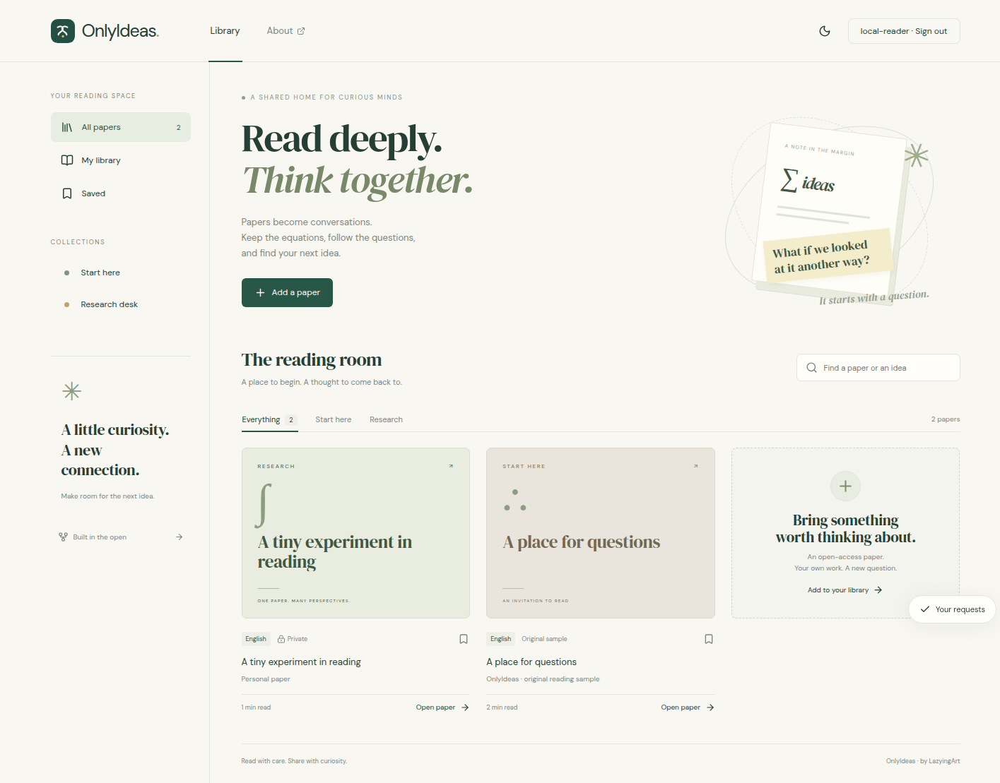

[English](README.md) · [العربية](i18n/README.ar.md) · [Español](i18n/README.es.md) · [Français](i18n/README.fr.md) · [日本語](i18n/README.ja.md) · [한국어](i18n/README.ko.md) · [Tiếng Việt](i18n/README.vi.md) · [中文 (简体)](i18n/README.zh-Hans.md) · [中文（繁體）](i18n/README.zh-Hant.md) · [Deutsch](i18n/README.de.md) · [Русский](i18n/README.ru.md)

[](https://github.com/lachlanchen/lachlanchen/blob/main/figs/banner.png)

# OnlyIdeas

Find research papers, read them in flowing text, and discuss the passages that
raise questions. OnlyIdeas keeps the source, figures, equations and translations
alongside your reading notes and conversations.

[Open the reading room](https://agent.onlyideas.art) ·
[App Store](https://apps.apple.com/app/onlyideas/id6816392935?platform=iphone) ·
[Mac App Store](https://apps.apple.com/app/onlyideas/id6816392935?platform=mac) ·
[Google Play](https://play.google.com/store/apps/details?id=art.onlyideas.app)



## Find and read

- Search by title, DOI, author or topic. Saved public papers open from the library;
  new requests look for an accessible source.
- Read supported PDFs and article pages as flowing text, with equations, figures
  and tables. Import authorized PDF, image, Word, Markdown or text files.
- Request a translation of a whole paper or a smaller passage. Read the original,
  translation or interlaced languages in one reader.
- Reuse existing public transcripts and compatible cached translations. A failed
  automatic download keeps its source link and an option to attach your own PDF.
- Save papers, adjust text and appearance, and keep processed papers offline.
  The paired iPhone can send public excerpts to Apple Watch in original,
  translated or interlaced form.

Source quality affects conversion. The original link remains available for
checking; generated translations and reading guides are labeled and can contain
errors.

## Questions and discussion

Ask the research assistant to find a paper, prepare it for reading or explain a
passage. Return to saved conversations, attach files and follow an import's
progress. Discuss a paper or a selected passage with other readers, and keep
personal notes in your account.

Public papers and their reusable reading material are shared. Chats, personal
notes, interests and private uploads remain account-scoped. To publish an upload,
select a suitable license and confirm permission; administrator review follows.
Unconfirmed sharing requests wait for review. Readers can report content and
block other readers.

Browse public papers without signing in. Importing, assistant requests and
comments require an account. Processing has usage limits, shown in the app.
OnlyIdeas app credits are non-transferable and have no cash value.

## Current release · 24 October 2026

**1.0.8 (34)** is public on iOS/Watch, Mac and Google Play.
**Android 1.0.9 (38)** is available to internal testers and submitted for Google
Play review. Apple 1.0.9 is being qualified.

The update adds saved-paper mentions with **@**, quoted messages, editable
research interests and public reading links. Copy a reading or research draft
for EchoMind or AiMemo, then send it yourself. Unsent questions and selected
references remain in place when the screen changes size. The Android Agent
toolbar also fits narrow screens more clearly.

[Current verification](store/review/cumulative-38-20261024.json) ·
[Current screenshots](store/screenshots/1.0.9-38/README.md) ·
[Previous submission](docs/latest-review-20261017.md)

## Platforms

OnlyIdeas has native iPhone/iPad, Android and Mac interfaces, a paired Apple
Watch reader, and a web/PWA reading room. Mac builds support Intel and Apple
silicon. The app has system, light and dark themes and 11 interface languages.

General subscription purchases and optional shared LazyingArt account/reward
integration remain disabled pending their separate qualification. An account in
another app does not automatically share its plan, balance or private data.

## Development

This repository contains the app and service code. Published, rights-cleared
paper bundles live in [OnlyIdeas-papers](https://github.com/lachlanchen/OnlyIdeas-papers).
Paper payloads and private account data do not belong in this source repository.

The reader preserves canonical MMD/TeX and source figures. Translations and
reading guides are separate, revision-keyed artifacts. The worker deduplicates
jobs and enforces page, byte and daily limits. Native navigation surrounds the
shared document renderer.

Read the operations guide before connecting providers. Keep credentials outside
Git in protected configuration files. Node 22 or newer is required.

```bash
npm ci
npm run check
npm run server
# In another terminal:
npm run dev
```

[Product contract](BRIEF.md) · [Architecture](docs/architecture.md) ·
[Operations](docs/operations.md) · [Native apps](docs/native.md) ·
[Mac and Watch](docs/apple-platforms.md)

## Support

| Donate | PayPal | Stripe |
| --- | --- | --- |
| [](https://chat.lazying.art/donate) | [](https://paypal.me/RongzhouChen) | [](https://buy.stripe.com/aFadR8gIaflgfQV6T4fw400) |

## Citation

Cite this repository when using it in research. GitHub reads CITATION.cff to offer a citation. [CITATION.cff](CITATION.cff)

```bibtex
@software{chen_onlyideas_app_2026,
  author = {Chen, Lachlan},
  title = {OnlyIdeasApp: Read deeply, think together},
  year = {2026},
  url = {https://github.com/lachlanchen/OnlyIdeasApp}
}
```
